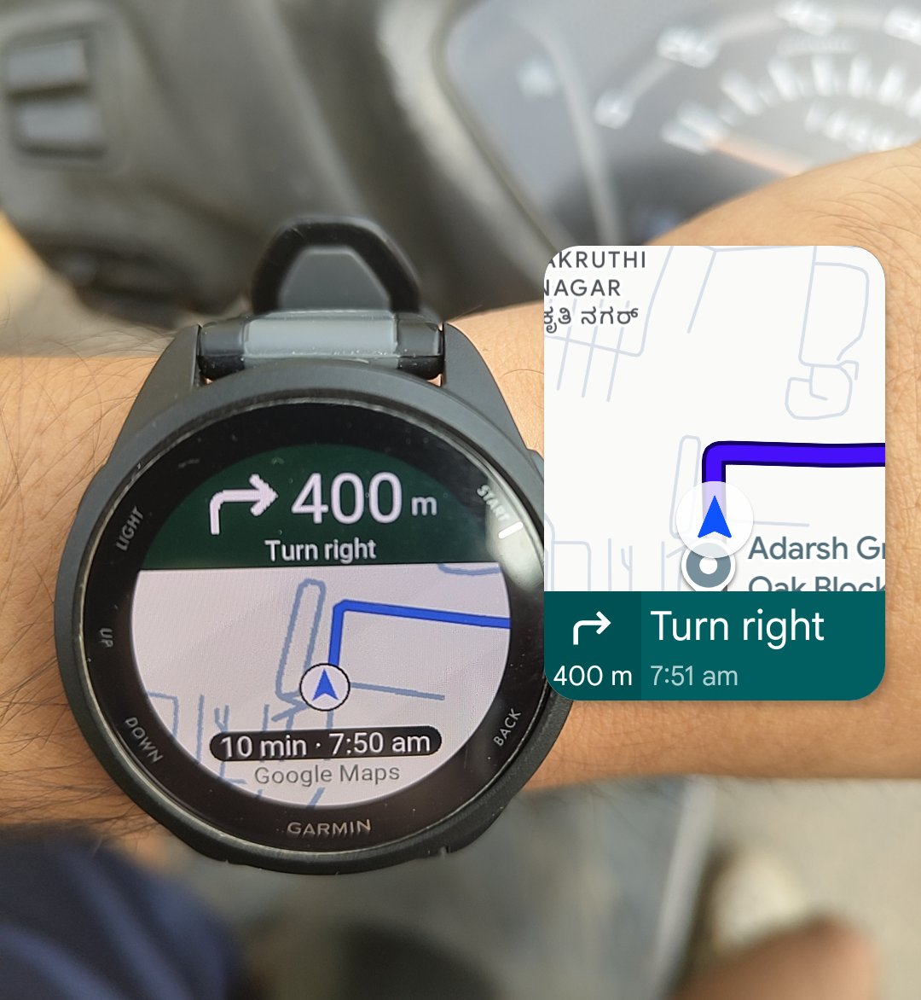

# NavMap

NavMap shows a map and the next turn on your **Garmin smartwatch** while **Google Maps** navigates on your **Android phone**.

It's two small apps: NavMap on the watch and NavBridge on the phone.

**Website & Guide:** [navmap.download](https://navmap.download/)  
**Garmin Watch App:** [Available on the Connect IQ Store](https://apps.garmin.com/apps/f18fe040-5bb7-41a0-afb0-f61edf418dab).\
**Phone App (Android):** [NavBridge.apk](https://github.com/Cube-VG/navmap-watch/releases/latest/download/NavBridge.apk) ([releases & checksums](https://github.com/Cube-VG/navmap-watch/releases/latest)).  
*Note: Precompiled `.prg` and `.iq` watch packages are not distributed for free. Developers can compile from source using the Connect IQ SDK (`bash tools/build-watch.sh`).*

## What you need

- A supported **Garmin circular AMOLED smartwatch** (19 models supported across 31 hardware variations):
  - **Forerunner**: 165, 165 Music, 265, 265s, 965
  - **Fenix & Epix**: Fenix 8 AMOLED (43mm, 47mm), Epix Gen 2, Epix Pro (42mm, 47mm, 51mm)
  - **Venu & vívoactive**: Venu 2, Venu 2 Plus, Venu 2s, Venu 3, Venu 3s, vívoactive 5
  - **Specialty & Aviation**: MARQ Gen 2, D2 Mach 1
  *(Note: Memory-in-Pixel [MIP] models such as Fenix 7, FR 255/955, and Instinct are not compatible due to their 64-color palette limitation. NavMap requires Connect IQ 5.0+ and an AMOLED high-contrast circular display).*
- An **Android phone** (Android 8 or newer) with **Garmin Connect** and **Google Maps**, and the watch paired in Garmin Connect. **iPhones (iOS) cannot run NavBridge** due to Apple notification sandbox restrictions.
- For a **source build**, a computer, the Connect IQ SDK and the watch's charging cable (see [the developer guide](docs/DEVELOPING.md)).
- A **Google account and a payment card**. Google wants a card on file before it gives you a Maps key, but one person's use normally stays inside the free allowance (see [What it costs](#what-it-costs)).

## Set it up

Follow the [website setup guide](https://navmap.download/setup.html) to install NavBridge, create your Google Maps key, grant permissions and pair the watch.

NavMap is on the [Connect IQ Store](https://apps.garmin.com/apps/f18fe040-5bb7-41a0-afb0-f61edf418dab). Developers who would rather not buy it can [build NavMap from source](docs/DEVELOPING.md); precompiled watch packages are not included in the GitHub release.

The older automatic setup scripts expect those watch packages, so their default download flow does not work with the current release. Use the source-build guide instead. Detailed manual instructions are in [docs/SETUP.md](docs/SETUP.md).

## Using it

1. In Google Maps on the phone, choose where to go, tap **Directions**, then **Start**.
2. The watch asks to open NavMap: press **START**.
3. The next turn, its distance and your arrival time appear straight away. Outdoors, the map appears once the watch has GPS, which takes a few seconds to a couple of minutes.

For the blue route line as well, start from Google Maps' **Share** button: open the place, tap **Share** and choose **Navigate with NavMap**.

For rides longer than 2 minutes, open NavMap on the watch first (press **START** on the watch face and pick NavMap), then start navigating. When the phone opens NavMap, the watch closes it again after about 2 minutes without a button press. If that happens, the watch asks to open NavMap again: press **START**.

## What the watch shows

- A light, high-contrast map, readable in sunlight: warm paper ground, blue-grey water and small roads, dark main roads. Like Google Maps it turns so the way you're going is up (the compass when you stand still), with you just below the centre so more road ahead shows. It slides as you move and zooms out when you go faster.
- The next turn with Google's arrow, the distance to it, the street and your arrival time, plus the blue route line ahead of you when you started with Share. If you take another way, a new line from where you are follows within seconds.
- Without internet on the phone the map can't load, but the turns and the route line carry on.
- Before each turn the watch buzzes twice, timed by your speed: one long buzz about 25 seconds before, and three short ones about 6 seconds before, when the turn banner turns blue. It lights up with each buzz and stays lit for the last 120 m.
- When the screen dims it shows just the next turn and the distance. Garmin lets an app keep the screen bright for only about a minute at a time.
- When you arrive, it says "Arrived" and closes. It records no activity.
- "Google" (or "Google Maps" in the store build) under the map. Tap the label (or press **START**) to see the map data credits for 5 seconds.

GPS needs open sky: indoors, the watch may wait for it forever.

## What it costs

NavBridge is free. NavMap costs **₹199 in India**, once, for lifetime access to the watch app. The international price is **US$1.99**, but the international checkout is still being set up; the Connect IQ Store lists the app as free because the seven-day trial comes first. Map pictures and route lines are billed separately by Google Maps Platform to your own Google Cloud account, which has a free allowance every month:

| | Free each month | After that, per 1,000 |
|---|---|---|
| Map pictures (Maps Static API) | 10,000 | $2 |
| Route lines for walking or cycling (Routes API) | 10,000 | $5 |
| Route lines by car | 5,000 | $10 |
| Route lines by motorbike | 1,000 | $15 |

The watch loads about 100 to 200 map pictures per hour of riding, so the free allowance covers roughly 50 to 100 hours a month. A route line is one request per trip, plus one each time you leave the route. These are Google's prices as of October 2026, lower in India; see [Google's pricing page](https://mapsplatform.google.com/pricing/). To avoid surprises, set a [budget alert](https://console.cloud.google.com/billing/budgets) on the billing account.

## If something isn't working

Check NavBridge's Setup list and the connection in Garmin Connect, then see the troubleshooting list in [docs/SETUP.md](docs/SETUP.md#troubleshooting).

## Privacy

NavBridge asks first, on its first screen, and nothing uses your location until you tap **Agree**. Then the watch sends its position to Google to get the map pictures, which Garmin Connect fetches for it, possibly through Garmin's servers. When you start with **Navigate with NavMap**, NavBridge sends your start and destination to Google for the route line. Both use your own key. NavBridge reads only Google Maps' navigation notification, keeps no record of where you've been, and combines your location with no other provider's data. Nothing is sent to NavMap's makers.

To withdraw, open NavBridge and tap **Withdraw consent** under **Privacy and terms**. NavBridge forgets your location, and the watch forgets your key and route line, until you agree again.

## Terms

NavMap includes Google Maps features and content, from Google Maps Platform. Their use is subject to the current [Google Maps End User Additional Terms of Service](https://maps.google.com/help/terms_maps/) and [Google Privacy Policy](https://policies.google.com/privacy).

NavMap is an independent project, not made by, affiliated with or endorsed by Google or Garmin. Google Maps is a trademark of Google LLC. Garmin and Forerunner are trademarks of Garmin Ltd. or its subsidiaries.

The notification reader is tested against 174 Google Maps notifications in 17 languages from [PebbleNTN](https://github.com/optio/PebbleNTN) (MIT).

## Licence

NavMap and NavBridge are **source-available, not open source**, under the [PolyForm Noncommercial License 1.0.0](LICENSE).

You may read, run, change and share the code for any noncommercial purpose: personal use, study, hobby projects, research, and use by charities, schools, public bodies and similar organisations. Building the watch app for yourself is allowed and documented in [docs/DEVELOPING.md](docs/DEVELOPING.md).

You may **not** sell it, bundle it into a paid product, or otherwise use it commercially. The one-time price of the watch app is the only commercial use the author permits. If you pass a build on to someone else, keep `LICENSE` and the copyright notice with it.

The PebbleNTN test data under `android/core/src/test/resources/pebblentn/` stays MIT, and so do the font and icon notices credited in [docs/SITE.md](docs/SITE.md).

## For developers

Building the apps, testing in the simulator, and how the watch and phone talk: [docs/DEVELOPING.md](docs/DEVELOPING.md).
